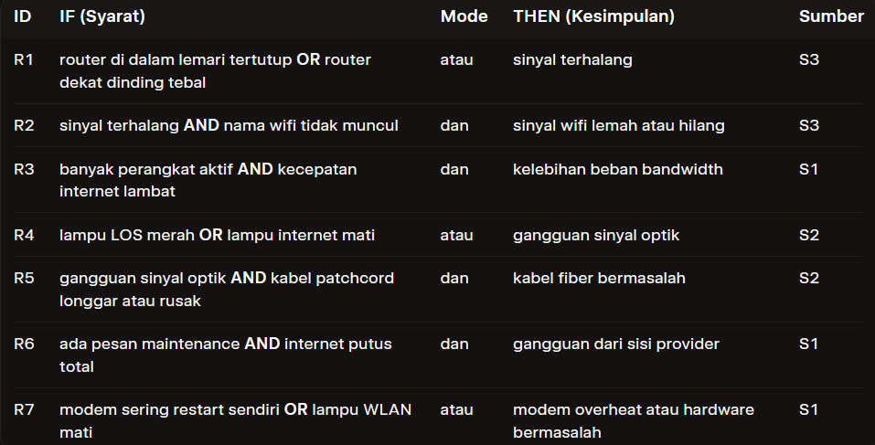
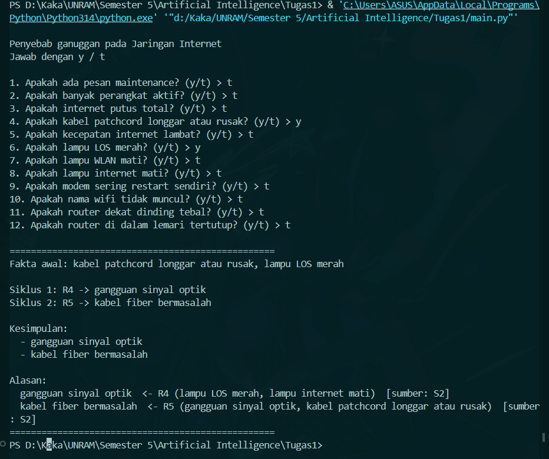
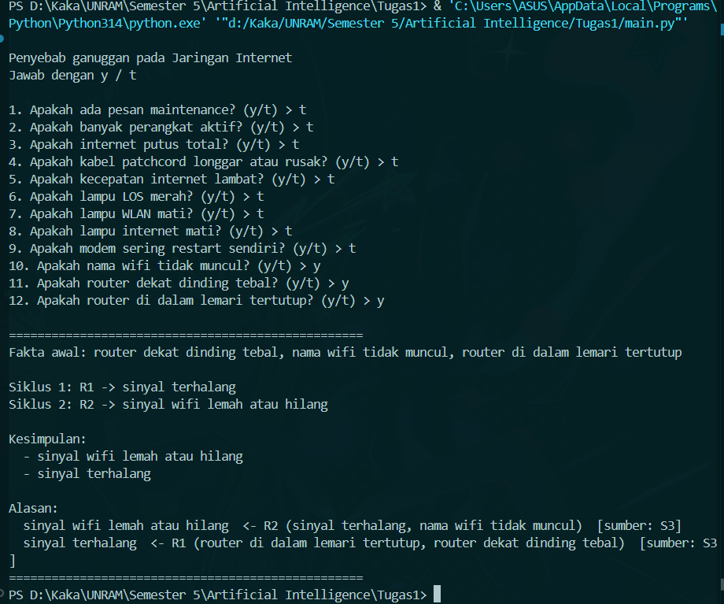
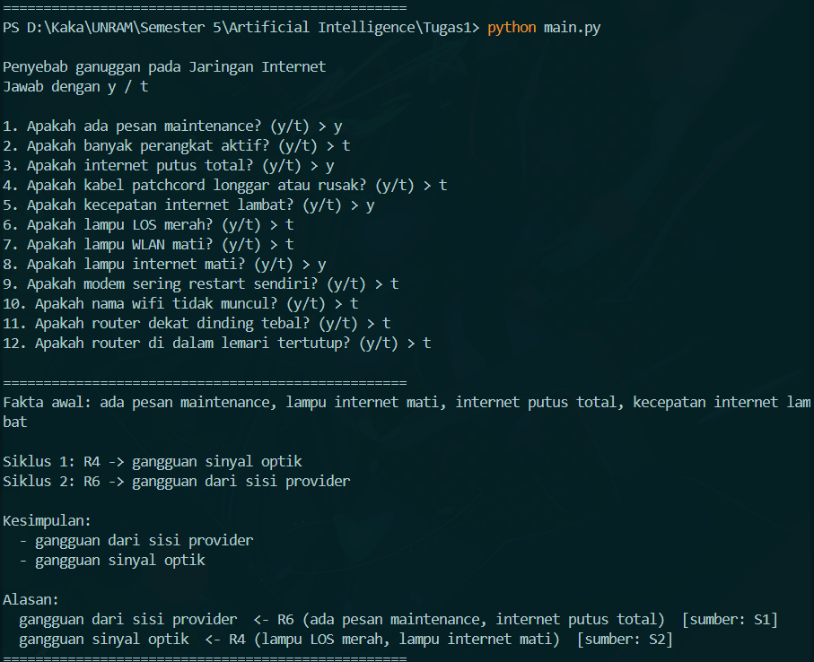

1. *Nama : Oktora Rizka Arifin | NIM : F1D02410145*

2. Topik : Gangguan Jaringan Internet
Cara menjalankan program 
Bahasa : python 
Versi : 3.12.10 
Cara menjalankannya dengan perintah : pyhton main.py, lalu pilih y/n sesuai dengan permasalahan yang sedang dialami

3. Daftar sumber 
judul :
  
    a. Sistem Pakar untuk Mendeteksi Kerusakan Jaringan Internet pada Indihome di Pematangsiantar
     
    b. Identifikasi Gangguan Koneksi Jaringan Internet Pada Indihome Plasa Telkom Muara Teweh Berbasis Sistem Pakar
     
    c. Analisis Gangguan Umum Pada Jaringan WI-FI Rumah Di RT 6/RW 2 Kelurahan Lawangan Daya dan Upaya Penanganannya
     
penerbit :  
    a. Jurnal Ilmu Komputer dan Informatika (JIKI) Vol. 2 No. 1, 2022 
    b. Computer Based Information System Journal, 2022 
    c. Jurnal lokal / artikel akademik 
URL :
  
    a. https://www.google.com/url?sa=t&source=web&rct=j&opi=89978449&url=https://ejournal.itn.ac.id/index.php/jati/article/download/10023/6316&ved=2ahUKEwisl9ixzuqXAxV2wzgGHccAIgQQFnoECCwQAQ&usg=AOvVaw2EOapGFJh_pKHTNZ9GzM-f 
     
    b. https://www.google.com/url?sa=t&source=web&rct=j&opi=89978449&url=https://jiki.jurnal-id.com/index.php/jiki/article/download/17/13&ved=2ahUKEwisl9ixzuqXAxV2wzgGHccAIgQQFnoECDEQAQ&usg=AOvVaw1vv6zMhJ8whAJUEDBTB27W
     
    c. https://www.google.com/url?sa=t&source=web&rct=j&opi=89978449&url=https://ejournal.omahtabing.com/knj/article/download/120/400&ved=2ahUKEwisl9ixzuqXAxV2wzgGHccAIgQQFnoECBsQAQ&usg=AOvVaw3hAxUgQnrHGB6sdA5V6PDU
     
tanggal akses : 
    a. diakses 3 Nov 2026 
    b. diakses 3 Nov 2026 
    c. diakses 3 Nov 2026 
tabel aturan.

4. Metode yang dipilih Fordwarch chainning, karena metode ini cocok untuk masalah diagnosa yang dimulai dari gejala/fakta yang diketahui user, Program mengumpulkan fakta terlebih dahulu, kemudian menjalankan aturan yang cocok secara berulang sampai tidak ada kesimpulan baru.

5. Tiga kasus uji dan screenshot-nya.

6. Batas keberlakuan, satu paragraf: Pengetahuan yang digunakan dalam sistem ini disusun berdasarkan jurnal yang membahas mengenai gangguan jaringan wifi dirumah. Sistem hanya mencakup masalah umum disisi user seperti posisi router, beban perangkat, indikator lampu modem, dan kondisi kabel patchcord. Hasil diagnosis yang diberikan bersifat saran awal dan bukan keputusan teknis final. Untuk gangguan massal, kerusakan fisik di luar rumah, atau masalah yang membutuhkan penanganan teknisi, tetap disarankan untuk menghubungi call center provider.

7. Penggunaan alat bantu AI  
saya menggunakan bantuan dari AI grok untuk mempelajari mengenai cara membuat sistem pakar sederhana dan memperbaiki struktur code yang masih error.